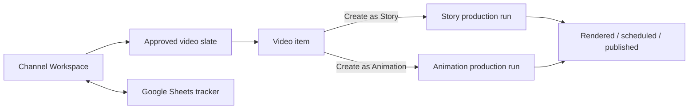

# Channel Workspaces and Content Planner

## Product decision

A Vidmyo project should represent one YouTube channel. Individual videos are durable items inside that channel's production queue. Story and Animations consume those items and create separate local production runs linked back to the channel and video item.

This should be a product workflow, not primarily a training course. Short explanations and examples belong inside the workflow; longer training can remain an optional learning product.



## Main navigation

Add a primary **Channels** section. It owns channel creation, research, planning and queue status.

Story and Animations keep their focused production interfaces. Both start with the same optional channel selector:

1. Choose channel.
2. Choose **Next ready video** or a specific video.
3. Vidmyo fills the title, hook, topic/angle, language, format, style and target duration.
4. Creating the production run claims the item and links its stable ID to `project.json`.

Users can still start an unlinked one-off video.

## Creating a channel

The first screen offers three paths:

### 1. Grow my existing channel

The user pastes their YouTube channel URL or handle. Vidmyo imports the public channel identity and recent uploads, identifies repeated themes and formats, and proposes gaps and follow-ups.

Connecting the user's YouTube account is optional for the initial public-data analysis. Private performance data such as impressions, click-through rate and audience retention requires explicit YouTube OAuth and a separate Analytics integration.

### 2. Model example channels

The user pastes one to five example channel links. Vidmyo studies their public uploads and extracts reusable patterns:

- content pillars and recurring subject families;
- title structures and hook types;
- typical length and long-form/Shorts mix;
- publishing cadence;
- unusually strong recent topics relative to each channel's own baseline.

Vidmyo must generate an original channel strategy. It should not clone names, scripts, thumbnails or a competitor's exact sequence of videos.

### 3. Start from a niche

The user supplies a niche, audience, language, goals and monetization model. Vidmyo uses guided choices for focus, style, length and cadence, then creates a new blueprint without requiring an existing channel.

## Guided setup

All three paths converge on one short wizard:

1. **Identity** — name, language, audience, country/market and channel URL if one exists.
2. **Positioning** — niche, promise, differentiator and subjects to avoid.
3. **References** — own channel plus optional example channels.
4. **Formats** — Story/Animations, visual style, long-form/Shorts ratio, duration and voice defaults.
5. **Publishing** — cadence and how many videos to plan now: 10, 20 or a custom bounded count.
6. **Monetization and safety** — intended revenue path, disclosure needs and channel-specific restrictions.
7. **Review strategy** — show the proposed pillars and assumptions before creating video ideas.

The planner then creates a draft slate. The user can accept, edit, delete, regenerate or reorder individual ideas before approving it.

## Video slate UI

The approved channel home should feel like a production board with a compact table view available.

### Header

- channel identity and active Google Sheet;
- **Create next video** primary action;
- **Plan 10 more**, **Refresh research** and **Sync tracker**;
- counts for Ready, In production, Review, Rendered and Published.

### Queue groups

- **Ready** — approved and free to claim;
- **In production** — linked Story/Animation project with progress;
- **Needs attention** — failed, blocked or awaiting review;
- **Rendered** — output exists and awaits publishing;
- **Scheduled / Published** — historical record;
- **Archived** — rejected ideas retained without cluttering the queue.

Each row shows video number, title, hook, format/style, priority, status, assigned agent, last update and the next useful action. Completed rows remain visible. A published video can be duplicated as a new follow-up, but is not silently reused.

**Create next video** selects the highest-priority Ready item. A secondary action lets the user choose any other Ready item. Claiming must be explicit and reversible until paid work or production starts.

## Stable data model

Google Sheet row numbers must not be identity. Rows move, filters and inserts change them, and the existing reference projects already show row/video-number drift.

### `channel.json`

```json
{
  "version": 1,
  "id": "channel_...",
  "name": "Example Channel",
  "youtube": {
    "channelId": "UC...",
    "url": "https://youtube.com/@example",
    "lastRefreshedAt": "2026-09-22T00:00:00Z"
  },
  "strategy": {
    "language": "English",
    "audience": "...",
    "positioning": "...",
    "pillars": [],
    "cadence": "2 long-form videos per week"
  },
  "defaults": {
    "kind": "story",
    "style": "doodle-v1",
    "aspect": "16:9",
    "durationSec": 480
  },
  "tracker": {
    "sheetId": "...",
    "tab": "Videos",
    "syncMode": "two-way-reviewed"
  }
}
```

### Video item

```json
{
  "id": "video_...",
  "sequence": 12,
  "title": "Working title",
  "hook": "Opening hook",
  "angle": "Topic and angle",
  "pillar": "Science mysteries",
  "kind": "story",
  "style": "doodle-v1",
  "priority": 70,
  "status": "ready",
  "claim": null,
  "productionProjectId": null,
  "sheet": { "lastKnownRow": 13, "revision": 4 },
  "researchEvidence": []
}
```

The local channel workspace is the source of truth for stable IDs and production links. Google Sheets remains the user's portable, editable planning and reporting surface.

## Status and claim contract

Use a bounded status vocabulary:

`draft → ready → claimed → producing → review → rendered → scheduled → published`

Side states: `blocked`, `skipped`, `archived`.

- A local single-user claim writes the claim, reads it back and verifies the value, following the proven `sheet_write.py` pattern.
- A multi-seat plan uses the Vidmyo service for an atomic lease; the sheet mirrors the lease.
- Claims contain user/device, timestamp and expiry. A stale claim is visibly recoverable, never silently stolen.
- Production milestones update specific tracker columns and verify every write.

## Google Sheets product

When a channel is approved, offer:

1. **Create my Vidmyo Tracker** — create a new Sheet in the connected Google account.
2. **Connect an existing tracker** — map and validate headers.
3. **Local only** — keep a local channel and export CSV later.

The public `Videos` tab keeps the proven 21 Doodle 1 columns. A hidden `_Vidmyo` tab stores stable video IDs, revisions, hashes and row mappings without polluting the user's table.

Synchronization must be reviewed when both sides changed. Show a field-level preview and let the user choose local, Sheet or merged values. Never overwrite a user's Sheet silently.

The current read-only Google scope is sufficient for importing an existing tracker. Creating and synchronizing trackers requires a separately explained Google Sheets write scope and an explicit write action.

## Channel analysis engine

Prefer supplied channel URLs over broad search. A known channel can be analyzed cheaply and accurately:

1. Resolve a handle with `channels.list(forHandle=...)`.
2. Read the channel's uploads playlist ID.
3. Read recent uploads with `playlistItems.list`.
4. Batch up to 50 video IDs into `videos.list` for public statistics and durations.

Research signals should be explainable:

- views per day with the collection timestamp;
- performance relative to that channel's recent median;
- recurring title/hook structures;
- topic recency and repetition across supplied references;
- optional search-demand evidence without invented search-volume numbers. The reference pipeline's autocomplete endpoint is undocumented, so it requires a product/legal review and must not be a launch dependency;
- fit with the user's chosen pillars, format and production capacity.

Call the result an **Opportunity score**, not a viral prediction. Show why an idea received its score and allow the user to remove any evidence or assumption.

Raw public YouTube API metadata and statistics must be refreshed or removed within 30 days. Store the user's approved strategy and original video ideas independently from the expiring raw research cache.

## Protecting Vidmyo's value

The user will see the final channel plan and prompts needed for their videos. The proprietary value should remain in the service:

- research selection and normalization rules;
- pillar balancing and duplicate-topic detection;
- opportunity scoring thresholds;
- slate composition, cadence and sequencing logic;
- mappings from a video item to Story/Animations production defaults;
- continuous improvements and refreshed research.

A copied Google Sheet contains a snapshot. It does not reproduce channel analysis, planning, claims, conflict-safe synchronization, production linkage or future updates.

## Recommended commercial packaging

- **Starter:** one local channel workspace, manual/imported tracker and a bounded slate.
- **Creator:** channel analysis, example-channel modeling, 10/20-video planner, generated Google Tracker, Flow extension and ongoing re-planning.
- **Studio:** multiple seats, server-backed claims, shared trackers, approval roles and audit history.

Sell the outcome as a **Channel Operating System**: strategy, a ready production queue and direct execution through Story/Animations. Training becomes an onboarding companion rather than the main deliverable.

## Implementation phases

### Phase 1 — Channel workspaces and local queue

- Add Channels navigation and durable `channel.json` / video-item storage.
- Import the official 21-column CSV or an existing Google Sheet.
- Show grouped statuses and choose Next ready/specific video.
- Link Story/Animations projects to `channelId` and `videoId`.
- Keep external Sheets read-only in this phase.

### Phase 2 — Guided planner

- Add niche/existing-channel/model-channel onboarding.
- Integrate public YouTube channel import and the existing honest keyword research approach.
- Generate and review 10/20-video slates through the user's chosen local agent or API.
- Keep the protected planning recipe server-side for subscription editions.

### Phase 3 — Tracker creation and reviewed synchronization

- Request explicit Sheets write scope.
- Create a copy of the official tracker in the user's Drive.
- Add hidden stable-ID metadata and verified writes.
- Add conflict previews, claims and milestone synchronization.

### Phase 4 — Team and performance loop

- Add server-backed atomic claims, roles and audit trail.
- Optionally connect the owner's YouTube Analytics data for CTR/retention insights.
- Feed completed-video outcomes into the next planning cycle while keeping claims about performance explainable.

## Acceptance principles

- A new customer can reach an approved 10-video queue without leaving Vidmyo.
- An existing creator can paste a channel link and review imported evidence before any plan is generated.
- Story and Animations both show the same channel/video selector and never duplicate queue state.
- “Next” can never select Published, Archived, Claimed or Blocked work.
- Sheet reordering does not break project identity.
- No generated idea is described as guaranteed viral.
- No Sheet, YouTube account or production status is changed without a clear user action and verified result.
