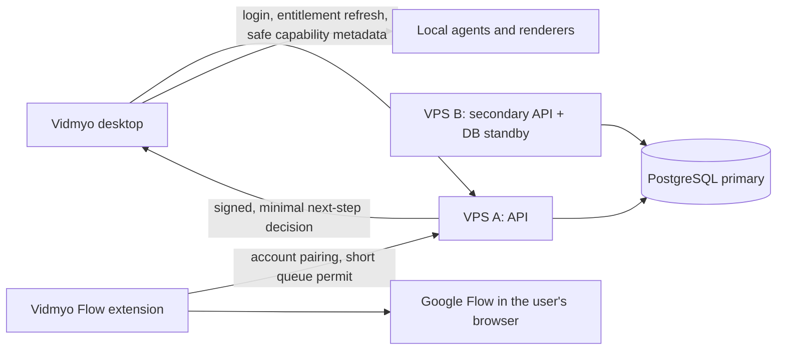

# Vidmyo local-first subscription architecture

## Product promise

Vidmyo performs media work on the customer's computer:

- source files, voice files, images, browser downloads and rendered videos stay local;
- FFmpeg, Remotion and the user's local agents consume the customer's CPU/GPU;
- provider keys stay in the desktop keychain and provider usage is billed to the customer's account;
- Google Flow runs in the customer's signed-in Chrome profile through the Vidmyo extension.

The Vidmyo service is a small control plane. It does not upload or render customer videos.

## What the two VPSs do

VPS A is the active control-plane role: reverse proxy, HTTPS API, browser sign-in callback, billing webhooks, entitlement signing, device registration and short team-claim leases. Its database is the write primary.

VPS B is the resilience role: a second stateless API process, encrypted backup staging and either a streaming PostgreSQL standby or a tested restore target. It can take traffic when VPS A is unhealthy after a deliberate failover procedure. It is not assumed to have spare capacity simply because it already exists.

The diagram describes a target design. The [measured VPS pilot](vidmyo-vps-pilot-readiness.md) selects the existing Hostinger KVM 2 machine as the primary candidate: it has 2 vCPU, about 6.4 GiB available RAM at audit time, and PostgreSQL already running alongside n8n. Vidmyo should use a separate database role and capped service. The smaller occupied OVH VPS is better suited to encrypted offsite backups or a prepared standby role.

Redis is optional at launch. PostgreSQL unique constraints and advisory locks are sufficient for idempotent billing events, background work and modest rate limiting.

## Capacity and cost drivers

These estimates assume 30% daily active users, 20 small control-plane requests per active user per day, no media traffic, no hosted model inference and two to three times burst headroom.

| Paying users | API calls/month | Combined server target | Live database | Network/month |
|---:|---:|---:|---:|
| 100 | 180,000 | 1–2 vCPU, 1–2 GB RAM | under 1 GB | under 1 GB |
| 1,000 | 1.8 million | 2–4 vCPU, 4–8 GB RAM | 2–5 GB | 5–15 GB |
| 10,000 | 18 million | 4–8 vCPU, 8–16 GB RAM | 10–30 GB | 50–150 GB |

The total server target is across both machines. Exact capacity depends on each VPS's vCPU, RAM, disk, bandwidth allowance and existing workloads. A VPS already running n8n or unrelated databases must be sized by measured free capacity, not its advertised plan.

Recurring cost depends on the actual VPS renewal terms, disk/backup retention, database replication, bandwidth allowance and overage policy, monitoring, transactional email, payment processing and support workload. Price these against the two selected providers and measured utilization before choosing a plan; this document deliberately does not invent a monthly price. Model and image costs can remain customer-paid through bring-your-own-key. Vidmyo should not proxy video files through the control plane.

## License and offline behavior

1. The desktop app signs in through the system browser using PKCE.
2. The service issues a short access token and a signed device entitlement.
3. The app refreshes the entitlement automatically in the background, normally once per day. The customer does not click, confirm or sign in again during normal use.
4. The last valid entitlement contains a 7-day offline grace period used only when the service or internet connection is unavailable.
5. The desktop verifies it with a public Ed25519 key; the signing key stays on the service.
6. The Chrome extension pairs with the same account and requests a short signed permit before starting a Vidmyo queue.

This keeps editing and rendering available during a temporary outage or a trip without internet. The seven-day period is a silent resilience window, not a recurring confirmation prompt. First activation, Google Flow, cloud AI providers and automatic periodic subscription verification still require internet. A permanently offline app cannot reliably enforce a monthly subscription.

### Phase 4A desktop contract

The desktop caches only a compact server-signed Ed25519 entitlement in the OS-backed encrypted store. The verifier accepts an injected or bundled **public** key only; the service signing key and any shared secret are never shipped to the app. Claims are strict and bounded: `accountId`, `deviceId`, `plan`, `issuedAt`, `expiresAt`, `offlineGraceUntil`, capability IDs and a signed active/revoked status.

At startup the desktop silently refreshes, then schedules one refresh every 24 hours. A connection failure or a 5xx service outage may use the last valid signed entitlement through its signed `offlineGraceUntil`. Authentication/revocation responses and malformed signatures never fall back to cached privileged access. After revocation or expiry outside grace, protected capabilities fail closed while local, unprotected projects remain readable.

The control-plane client accepts only `VIDMYO_SERVICE_URL` as a credential-free HTTPS origin and constructs fixed endpoint paths below it. Refresh requests contain no project, media, prompt or pipeline payload. Team queue claims use a fixed compare-and-set contract: `itemId`, `expectedRevision`, bounded `leaseMs` and an idempotency key; renewal additionally carries the server-issued lease ID. Responses are reduced to claim ID, revision and lease expiry, so a service cannot use this endpoint to return proprietary instructions or prompts.

## Protecting the pipeline

Installed JavaScript, Python, prompts and shell commands can be inspected by a determined customer. Obfuscation raises the effort but does not make shipped logic secret.

The protected design separates the product into two parts:

- The service retains entitlement rules, plan limits, routing policies, quality thresholds, evolving decision logic and proprietary planning recipes.
- The desktop contains generic, signed adapters that perform local operations such as writing files, invoking agents, running FFmpeg and rendering Remotion compositions.

The service returns only the next permitted operation and the minimum parameters needed to perform it. It does not return an entire internal SOP or expose directive files. Requests and responses use stable public capability IDs rather than internal filenames or pipeline names.

Anything required for a local operation can still be observed at that moment. In particular, prompts exported to a Flow queue are visible to the customer. The commercial advantage therefore combines access control with continuous recipe updates, reliable automation, templates, account services and the maintained Flow integration; it does not depend on one hidden prompt.

## Chrome extension licensing

The extension contains no Google password or OAuth secret. It uses the customer's already authenticated Flow tab. Vidmyo licensing should use:

- Chrome Web Store distribution for controlled updates;
- one-time pairing with the Vidmyo desktop/account;
- device registration and short signed queue permits;
- permit claims for account, plan, device, project hash, scene count, expiry and nonce;
- server-side rate limits and revocation;
- no shared secret embedded in the extension.

A modified extension can bypass its own local checks. Keep valuable changing rules on the service and treat extension checks as subscription enforcement and abuse resistance, not cryptographic concealment of shipped source.

## Launch topology

- VPS A: reverse proxy, API instance, billing webhook worker and PostgreSQL primary.
- VPS B: second API instance, streaming PostgreSQL standby and encrypted backup staging.
- Backups: daily encrypted copy outside the VPS provider/account, with 7 daily, 4 weekly and 6 monthly restore points.
- Monitoring: API latency/5xx, webhook backlog, disk, database connections, replication lag, entitlement refresh failures and backup age.
- Security: TLS, closed database ports, least-privilege database roles, raw-body webhook verification, idempotent event storage, secret redaction and quarterly restore tests.

At roughly 1,000 paying customers, or sooner if one hour of license-service downtime is commercially costly, move PostgreSQL to a managed high-availability service. Keep the two VPSs as stateless API nodes.
